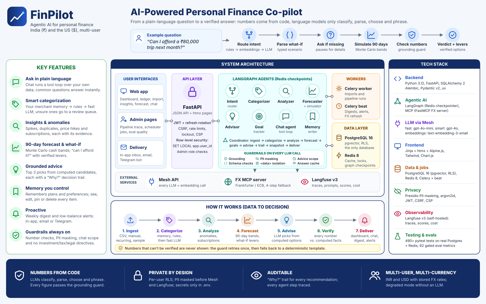
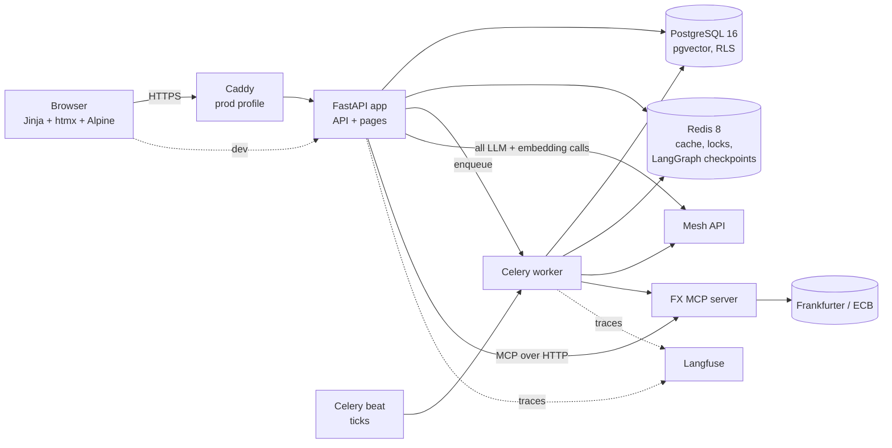
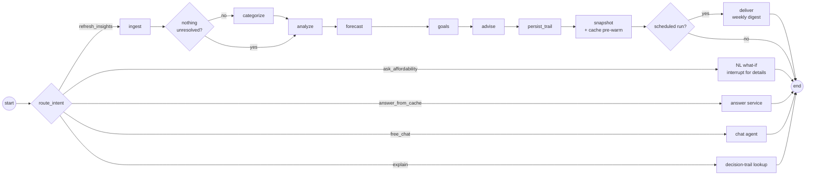

# FinPilot

**A proactive, multi-agent personal-finance co-pilot.** It's multi-user and works in India (₹) and the US ($).

FinPilot categorizes your transactions, finds anomalies and forgotten subscriptions, forecasts your cash 90 days ahead, simulates "can I afford it?", and turns all of that into specific advice. It answers questions in a chat, remembers what you tell it, and sends a weekly digest and low-balance alerts.

The rule behind every feature: **numbers come from code; language models only classify, parse, choose and phrase**. Every number an LLM writes is checked against computed facts before anyone sees it.

- **Stack:** FastAPI + Jinja/htmx/Alpine UI, PostgreSQL 16 (pgvector, row-level security) as the only database, Redis, Celery + beat, LangGraph (Redis checkpointer) and Langfuse.
- **Models:** every LLM and embedding call goes through the Mesh API.
- **Exchange rates:** come from our own FX MCP server, with a four-step fallback chain.

---

## Quickstart (5 commands)

```bash
cp .env.example .env
$EDITOR .env                     # set MESH_API_KEY (everything else has working defaults)
docker compose up --build -d     # app, worker, beat, fx-mcp, Postgres, Redis, Langfuse
docker compose exec app python -m scripts.seed_demo   # 4 demo accounts with sample data (below)
open http://localhost:8000       # sign in, or register (the first registered account becomes admin)
```

- **Langfuse:** http://localhost:3000. Login: `LANGFUSE_INIT_USER_EMAIL` / `LANGFUSE_INIT_USER_PASSWORD` from `.env`. The project and API keys are created headlessly on first boot.
- **Without a Mesh key:** the app still works in *degraded mode* (rules-only categorization, template advice, no chat), and says so in the UI.
- **Demo accounts:** created by step 4 of the Quickstart, which runs the seed script inside the `app` container of the Docker stack:

  ```bash
  docker compose exec app python -m scripts.seed_demo
  ```

  If you run the app locally with uv instead of Docker (see [Local development](#local-development-uv)), run `make seed-demo` from the repo root. It runs the same script on your machine. Running either command again is safe: existing accounts are kept, and sample data is only loaded where it's missing.

  All four accounts use the password `FinPilot-demo-2026!`. It's for local development only: in production the script refuses to run unless `DEMO_PASSWORD` is set to a different password.

  | Account | Role | Reporting currency | Data |
  |---|---|---|---|
  | `admin@finpilot.local` | admin (sees Pipeline and Quality) | INR | none: try **Load sample data** |
  | `inr@finpilot.local` | user | INR | rupees only |
  | `usd@finpilot.local` | user | USD | dollars only |
  | `mixed@finpilot.local` | user | INR | rupees and dollars |

- **Sample data** lives in the repo: [`data/sample/`](data/sample/) has three CSVs in the import template's format (2026-04-01 → 2026-10-15, plain descriptions like "Swiggy order", every row categorized) plus `datasets.yml` with the recurring items each declares. Any account can load one with **Load sample data** (dashboard for new accounts, Import page, or *Add ▸ Load sample data*); dates move forward by whole months so the last month is the current one, and it undoes from the Import page. The files can also be uploaded on the Import page as-is. Each includes planted events for Insights: a duplicate charge, a large first-time purchase, a subscription price rise, a bill spike and a month of heavy food delivery. Regenerate with `uv run python -m scripts.build_sample_data` (deterministic).
- **Production:** HTTPS with Caddy and backups; see [DEPLOY.md](DEPLOY.md).

## What you can do

| Area | What it does |
|---|---|
| **Accounts & data** | Register/login (argon2id, refresh-token rotation with reuse detection, CSRF, rate limits, lockout, password reset). Add expenses/income in any currency (shown in your reporting currency at the stored rate of that day). Import CSV/XLSX through a template with preview and undo. Recurring bills and income. Custom categories with merge and recategorize-preview. Export everything as JSON, or delete your account. |
| **Categorization** | Layered: your merchant memory → rule lexicon → fast LLM for unique unresolved merchants (batched, few-shot from your own labels). Low confidence goes to a review queue instead of a guess. |
| **Insights** | Anomalies (spikes, duplicates, price hikes, unusually large first-time charges), detected recurring payments, subscription audit ("likely low value (heuristic)", never "unused"), spending patterns, foreign-currency exposure. Every finding states its metric, baseline, threshold and evidence transactions. |
| **Forecast & what-if** | 90-day Monte Carlo cash forecast (p10/p50/p90, payday and weekday effects, scheduled bills, FX volatility). What-if scenarios in plain language ("can I afford a ₹80,000 trip next month?"). The simulator asks for missing details, re-simulates, and proposes *verified* levers (delay, instalments, a category cut). |
| **Advice** | Deterministic candidates with simulated effects; the smart model picks and phrases the top 3. Each recommendation cites findings, names a merchant/category/goal, passes the grounding guard, and has a "Why?" trail (trigger, findings, evidence, forecast numbers, model, prompt version, grounding report). Dismissals are remembered. |
| **Ask & chat** | Common questions ("where am I spending the most?") are answered instantly from a layered cache. A chat assistant runs a tool loop over your data (transactions, trends, forecast, simulate, subscriptions, goals, recurring, recommendations, memory, currency conversion). Tool progress streams live; only verified answers are shown. |
| **Memory** | Remembers plans and preferences you mention ("Netflix is shared with family, don't suggest cancelling it") and your responses to advice. The Memory page lets you see, edit, pin and delete all of it. |
| **Proactive** | Weekly digest at your chosen local day and hour (one insight, one action with its simulated effect, goals, bills, notices); low-balance alerts; in-app inbox, email or Telegram. |
| **Transparency** | For admins: the Pipeline page traces every agent step (timings, skips, degraded mode, resume) and shows the scheduler jobs; the Quality page shows the evaluation suites, gates, trends, failures and run comparison. Both are hidden from other users. |
| **Guardrails** | Numbers: every figure an LLM writes is checked against computed facts (grounding guard) and outputs must match their schemas. Privacy: card, account, Aadhaar, PAN, phone, email, UPI and IFSC identifiers are masked with Presidio before anything reaches Mesh or Langfuse, and an answer that contains one is blocked. Scope: chat only talks about your money (off-topic requests get a fixed reply) and never gives specific investment, tax or legal directives. Injection: untrusted text (descriptions, notes, tool output) always sits inside `<data>` blocks, tools and MCP calls are allow-listed, and chat tools are read-only. Each guardrail is measured in the eval suites and reported as a Langfuse score. |

## Architecture

[](docs/architecture.svg)

The overview above shows the features, components, tech stack and data flow on one page. The diagrams below show how the services connect and how the coordinator runs the agents.



**The coordinator** (`finpilot/agents/coordinator.py`) is one LangGraph graph with Redis checkpoints. Every node commits its own transaction, so a crashed run resumes at the failed node.



### How the agents cooperate

| Agent | Produces | Consumes | LLM role |
|---|---|---|---|
| **Categorizer** | category + confidence + source per transaction; merchant memory | transactions, your labels, taxonomy | classify unique merchants (fast model), validated against your category list |
| **Analyzer** | findings (metric, baseline, observed, threshold, evidence ids), detected recurring series, subscription audit | categorized ledger | none (deterministic); optional grounded summary |
| **Forecaster / simulator** | balance bands, verdicts, scenario deltas, verified levers | ledger, recurring, goals, FX rates | parse the what-if question into a typed scenario (fast model); never numbers |
| **Advisor** | top-3 recommendations + decision trail | findings, candidates with simulated effects, goals, memories | choose among computed candidates and phrase them (smart model) under the grounding guard |
| **Goal tracker** | weekly goal snapshots and deltas, "ahead of plan" findings | forecast | none |
| **Intent router + answer service** | instant answers with cache layer and latency | question, deterministic facts | route (rules → embeddings → fast model); phrase facts (grounded) |
| **Chat agent** | verified answers, tool trace | tools over the user's data, memories, short-term history | tool calling (smart model); every number must come from a tool |
| **Memory writer** | long-term memories (kind, topic, expiry) | idle chat sessions, advice decisions | extract durable facts (fast model); code decides merge/supersede |
| **Coordinator** | pipeline runs, agent_runs trace, snapshots, digests | all of the above | none |

**Contracts:**
- Agents exchange typed Pydantic models and database rows, never free text.
- LLM output is schema-validated.
- Untrusted text (descriptions, notes, CSV, memories, tool output) is passed inside `<data>` / `<memory>` blocks.
- Anything numeric that a user sees is either computed by code or verified by `finpilot/trail/grounding.py`. Otherwise the deterministic template is shown instead.

## Mesh usage

- **One module:** `finpilot/llm/client.py` is the only file allowed to import a model SDK or hold an LLM URL. A test scans the repo for violations.
- **Models (env-configurable):**
  - `MESH_MODEL_FAST` (`openai/gpt-4o-mini`): categorization, parsing, routing, phrasing, memory extraction.
  - `MESH_MODEL_SMART` (`openai/gpt-4o`): advice, chat.
  - `MESH_MODEL_EMBED` (`openai/text-embedding-3-small`): intent routing, semantic cache, memory.
- **Prompts are versioned files:** `prompts/<agent>/<name>.vN.md`, STATIC part first so provider prefix caching applies. A test forbids prompt text in `.py`.
- **Caching:**

  | Layer | Where | Scope |
  |---|---|---|
  | L0 | provider prefix cache | cached tokens are recorded |
  | L1 | exact LLM response cache (`cache:llm:`) | makes evals reproducible |
  | L2 | answer cache | keyed by data_version, currency, prompt version, model, date bucket and FX as-of; invalidated by version, never by scanning |
  | L3 | pgvector semantic cache | same user, same data version |

  Concurrent misses are single-flighted, and the common questions are pre-warmed after every pipeline run.
- **Embeddings:** served by Mesh. Without them, memory falls back to Postgres full-text and trigram search.
- **Observability:** every call is a Langfuse trace with a hashed user id, session, prompt name and version, cost, and scores (grounding pass, cache hit, user feedback, degraded).

## Evaluation (real numbers)

Nine suites run on six seeded synthetic personas with ground truth: three reporting in INR and three in USD, two of them cross-currency. The FX & MCP suite uses a fixed reference rate table instead.
- **`make eval-offline`** (free, deterministic, gated in CI).
- **`make eval`** (Mesh, a few cents).

Results go to Postgres, Langfuse and the **Quality** page; the committed report is [`eval/results/RESULTS.md`](eval/results/RESULTS.md). The numbers below are from the committed full run.

| Suite | Result |
|---|---|
| Categorization (6 personas, gpt-4o-mini via Mesh) | **87.4% accuracy**, macro-F1 0.83; 96.3% of transactions resolved; rules + memory alone are right 90.8% of the time they answer; merchants never seen before: 69.5%; prompt-injection descriptors never followed |
| Anomalies (spikes, duplicates, price hikes, large one-offs) | precision 56%, recall 86% on material anomalies, 0.20 false alarms per month on clean personas; **held-out personas (new seeds, never inspected): precision 53%, recall 78%, 0.28 false alarms per month** |
| Recurring detection | precision 96%, recall 100%, period 100%, next date within ±3 days 100%, amount error 2.7% |
| Recurring materializer | 100% correct (month-end, biweekly, quarterly, catch-up) and idempotent |
| 90-day cash-flow forecast (24 backtests) | actual balance inside the 10–90% band on 77% of days (target 80%); 62% less error than "repeat the trailing average", 42% less than "repeat last month" |
| What-if simulator | 282/282 property checks hold (a purchase never raises any path, cancelling saves exactly charge × occurrences, …) |
| Advisor (gpt-4o via Mesh, 6 personas) | 100% of recommendations cite a finding, name a specific merchant/category/goal and have every number grounded in computed facts; 83% pass grounding on the first try; LLM-as-judge 4.8/5; dismissed advice never repeated |
| Grounding guard | caught every deliberately corrupted number (scaled, fabricated, wrong currency) in real recommendation texts in the committed runs and never rejected a clean one; an earlier run missed 1 of 40 by coincidental match (see DESIGN_NOTES §8) |
| Answer cache (200-question session, Mesh) | 87.5% of cacheable answers served from cache; cached p95 5 ms vs 5.6 s computed; every write invalidated the next answer, and no answer crossed users; intent router 34/35 phrasings |
| Memory & chat (Mesh) | remembered facts recalled in the top 5 for 95% of user-style questions (90% at rank 1); contradictions replaced, deleted memories forgotten, account numbers never stored (all 100%); chat answers fully verified 9–10 of 10 across runs, never showing an unverified number |
| FX & MCP (no network) | conversions exact against a reference table, USD→INR→USD within $0.01, weekend/holiday dates, all four fallback scenarios (MCP down, HTTP down, stale DB, pinned) with the right flags, MCP contract/allowlist/circuit breaker, converted amounts grounded, fx_exposure matches ground truth (all 100%) |
| Accessibility (axe-core, WCAG 2.1 AA) | 0 violations on 17 pages in both light and dark mode (`make a11y`) |

**Honesty notes** (details in RESULTS.md and DESIGN_NOTES.md):
- These are synthetic personas, so treat the numbers as regression signals.
- The anomaly threshold was tuned once on the main personas, which is why the held-out numbers are reported next to them.
- The router's rule patterns were written together with the cache eval phrasings.
- One simulator parser prompt and one router rule were revised after a first run on their own eval sets. Each such change is disclosed where it applies.

## Local development (uv)

```bash
make up-deps                 # Postgres + Redis (+ fx-mcp) in Docker
uv sync                      # Python 3.12 deps
uv run alembic upgrade head
make run                     # API + UI on :8000 with reload  (make worker / make beat in other shells)
make test                    # pytest (real Postgres + Redis; the test DB is re-created)
make lint                    # ruff + format check + mypy
make eval-offline            # deterministic eval suites with gates
make e2e && make a11y        # Playwright smoke test and axe audit against the running stack
make help                    # everything else
```

Decisions, trade-offs and verified third-party facts are in [DESIGN_NOTES.md](DESIGN_NOTES.md). Conventions for contributors (and coding agents) are in [CLAUDE.md](CLAUDE.md). How the project was built (the brief and the phase plan and log) is in [docs/build-process/](docs/build-process/).

### Langfuse
- **Self-hosted (default):** vendored in `deploy/langfuse/` and pulled in with Compose `include:`.
- **Langfuse Cloud:** set `LANGFUSE_HOST_INTERNAL` and the keys, then start only FinPilot's services:
  ```bash
  docker compose up app worker beat fx-mcp finpilot-postgres finpilot-redis
  ```
- **Where to look:** traces are tagged `agent:<name>`. Eval runs appear as dataset runs with scores. Prompts can be synced with `make prompts-sync` (the files stay the source of truth).

## API

All routes require authentication except auth and health. Interactive docs are at `/docs`.

| Group | Routes |
|---|---|
| Auth | `POST /auth/register` `login` `logout` `refresh` `password/change` `password/forgot` `password/reset` |
| You | `GET/PATCH /me`, `GET /me/export`, `DELETE /me`, `GET/PATCH /settings`, `GET/POST /me/sample-data`, `GET /currencies`, `POST/DELETE /settings/telegram[/link]` |
| Ledger | `GET/POST /transactions`, `GET/PATCH/DELETE /transactions/{id}`, `PATCH /transactions/{id}/fx`, `GET /transactions/review-queue`, `GET /transactions/export.csv`, `GET/POST/PATCH/DELETE /categories…`, `POST /categories/{id}/merge`, `POST /categories/recategorize/preview\|apply`, `GET /categories/suggest` |
| Recurring & import | `GET/POST/PATCH/DELETE /recurring…`, `POST /recurring/{id}/pause\|resume\|skip-next`, `GET /recurring/detected`, `POST /recurring/detected/{id}/promote\|dismiss`, `GET /import/template.csv\|template.xlsx\|schema`, `POST /import/upload`, `POST /import/{batch}/confirm\|undo` |
| Intelligence | `GET /dashboard`, `GET /insights`, `GET /subscriptions`, `GET /forecast`, `POST /simulate`, `POST /simulate/ask[/{thread}/resume]`, `GET/POST/PATCH/DELETE /goals…`, `GET /recommendations`, `POST /recommendations/{id}/accept\|dismiss\|feedback`, `GET /recommendations/{id}/trail` |
| Answers & chat | `GET/POST /answers`, `GET /answers/stats`, `POST /chat`, `POST /chat/stream` (SSE), `GET /chat/sessions[/{id}]`, `POST /chat/messages/{id}/feedback`, `GET/DELETE /memory`, `PATCH/DELETE /memory/{id}` |
| Pipeline & delivery | `POST /pipeline/run`, `GET /pipeline/runs[/{id}[/events]]`, `POST /pipeline/runs/{id}/resume`, `GET /digests[/{id}]`, `GET /alerts`, `POST /alerts/{id}/read`, `GET /scheduler/jobs` (admin), `POST /digest/preview` (admin) |
| FX | `GET /fx/convert`, `GET /fx/rates`, `GET /fx/status` |
| Evaluation | `GET /eval/runs[/{id}[/cases]]`, `GET /eval/compare`, `POST /eval/run` (admin) |

## Limitations

- **Only synthetic data has been evaluated;** real bank descriptors are messier.
  - Single-charge spikes at high-variance merchants (Amazon, Walmart) are the analyzer's weakest spot.
- **Currencies:** two are supported (INR base, USD). FX uses daily ECB reference rates, not your bank's card rate.
- **Accounts:** one combined balance. Card spending and card-bill payments are not yet modelled as separate accounts.
- **Subscriptions:** "Likely low value" is a heuristic (cost and your own usage rating). FinPilot cannot see whether you use a service.
- **Grounding** checks that a number exists among the facts, not which fact it claims to be. A coincidental match is possible (measured; rare).
- **Chat answers are grounded but not judged for relevance;** the eval checks them by hand.
- **Not yet built:** email verification and OAuth sign-in.

## Roadmap

- Separate card and bank accounts, with transfers.
- A held-out persona set for every suite, and a real-data pilot with consent.
- A semantic grounding check (which fact a number claims to be).
- Per-merchant dispersion-aware spike thresholds.
- More currencies via the FX MCP server (the provider already supports them).
- Bank-statement PDF import.
- Push notifications.

## License

[MIT](LICENSE)
