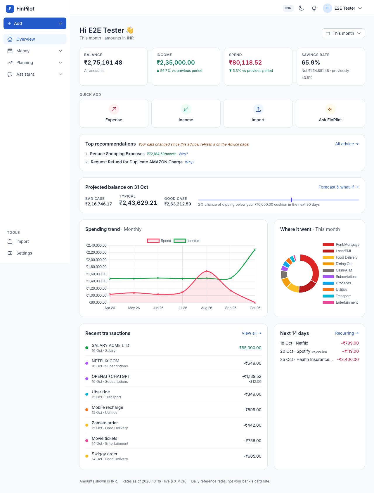
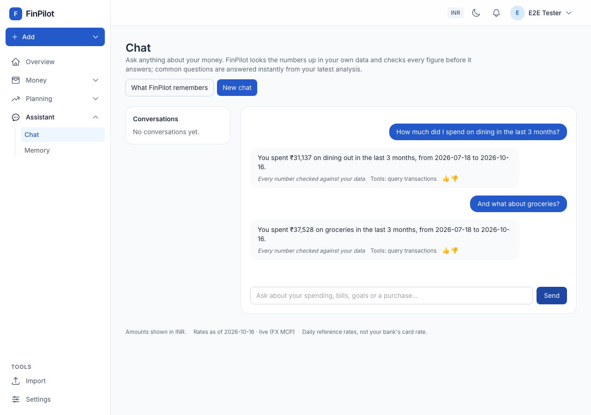

# FinPilot user guide

FinPilot keeps track of your spending and income, warns you about anything unusual, forecasts your balance for the next 90 days and answers questions about your money. This guide shows you how to use it, task by task.

**One rule to know:** every number FinPilot shows is calculated from your own data. The AI sorts transactions into categories, understands your questions and writes the wording. It never makes up a figure, and FinPilot checks every number the AI writes against your data before you see it. Text marked *"AI-written, numbers checked"* has passed that check.

## Contents

1. [Get started in five minutes](#1-get-started-in-five-minutes)
2. [Add your money](#2-add-your-money)
3. [Find and fix transactions](#3-find-and-fix-transactions)
4. [Categories](#4-categories)
5. [Recurring bills and income](#5-recurring-bills-and-income)
6. [Insights: what's unusual](#6-insights-whats-unusual)
7. [Forecast, what-if and goals](#7-forecast-what-if-and-goals)
8. [Advice](#8-advice)
9. [Chat and memory](#9-chat-and-memory)
10. [Digests, alerts and the inbox](#10-digests-alerts-and-the-inbox)
11. [Settings, your data and privacy](#11-settings-your-data-and-privacy)
12. [Tips and FAQ](#12-tips-and-faq)

---

## 1. Get started in five minutes

1. **Sign in or register.** If someone set up FinPilot with demo accounts, you can sign in as `inr@finpilot.local` (rupees), `usd@finpilot.local` (dollars) or `mixed@finpilot.local` (both). The password is in the [README](../README.md#quickstart-5-commands). Otherwise, click **Register**.
2. **Confirm your currency.** New accounts are asked how they want to see their money: in **INR** or **USD**. You can change this later in **Settings**.
3. **Add some data.** If you just want to look around, use **Add ▸ Load sample data**: about six months of realistic transactions, ending this month. You can remove it again from the **Import** page.
4. **Read the Overview.** The home page shows your balance, income, spending and savings rate for the period you choose (top right: this month, last 30 days, 3, 6 or 12 months). Below that are your top recommendations, your projected month-end balance, your spending trend, where your money went, recent transactions and bills due in the next 14 days.

**Finding your way around.** The sidebar groups the pages:

| Group | Pages |
|---|---|
| **Overview** | Home page with your key figures |
| **Money** | Transactions, Recurring, Categories |
| **Planning** | Forecast & goals, Advice, Insights |
| **Assistant** | Chat, Memory |
| **Tools** | Import, Settings |

The top bar shows your reporting currency. It also has a light/dark switch, the **bell** (your inbox of digests and alerts) and your account menu.

## 2. Add your money

### One transaction at a time

Click **Add ▸ Expense** or **Add ▸ Income** (these are also on the Overview and the Transactions page). Fill in:

- **Amount** and **Currency.** You can use any supported currency. A foreign amount is converted using the reference rate for that day and shown in your reporting currency. The original amount is always kept.
- **Date.** Pick it from the calendar, or type it: `15/10/2026`, `15 Oct`, `Oct 15 2026` and `2026-10-15` all work. Dates are read day first.
- **Description / merchant**, for example "Swiggy order" or "Rent October".
- **Category.** Leave it on **Let FinPilot decide** and it will choose one for you.
- **Repeat this** (optional). Turns the entry into a recurring item (every *n* days, weeks, months…, optionally until an end date).

### Import a bank statement

Open **Import** (under Tools):

1. **Download the template** (CSV or Excel) and copy your bank's rows into it, or upload your own file.
2. **Upload your file**, then **map the columns** (date, description, amount and so on) if FinPilot hasn't guessed them correctly.
3. Check the **Preview**. Rows FinPilot can't read are listed under **Rows needing attention**.
4. Import. Everything is categorized for you. If something went wrong, click **Undo this import**. **Import history** lists every past import.

## 3. Find and fix transactions

**Money ▸ Transactions** lists everything, newest first.

- **Filter** by text (description, merchant or notes), category, type (expense or income) and **Period**: this month, last month, last 7, 30 or 90 days, this year, last year, or **Custom range** with your own From and To dates. A preset period applies as soon as you pick it. **Reset** clears all filters.
- **Badges under each row** show how the row was entered (manual, import…) and how its category was chosen (your own choice, your memory of that merchant, a rule, or the AI, with its confidence). Rows marked **review** are ones FinPilot wasn't sure about. Click the "*n* to review" link at the top to see only those.
- **Change a category** with the drop-down on the row. If the row has a merchant, FinPilot asks whether to use the same category for **every past and future transaction from that merchant**. Say yes and it will remember.
- **Foreign-currency rows** show the original amount with a **rate** link. Click it to enter the exact rate your bank charged, or leave it empty to go back to the reference rate.
- **Export CSV** downloads the list. **✕** deletes a row.

## 4. Categories

**Money ▸ Categories** lists the built-in categories and any you create.

- **+ New category.** Give it a name, choose whether it's for expenses or income, and add **keywords** (for example `vet, petco`). Transactions whose description contains a keyword go into that category.
- After you add or change keywords, FinPilot offers to **re-categorize existing transactions**. It shows what would change before applying anything.
- **Manage** a category to edit it, **merge** it into another, archive it or delete it.

## 5. Recurring bills and income

**Money ▸ Recurring** holds salary, rent, subscriptions, EMIs and anything else that repeats.

- **+ New recurring item:** expense or income, amount, how often (daily, weekly, every 2 weeks, monthly, quarterly, yearly), start date and an optional end date. FinPilot adds the transactions on their due dates.
- **Manage** an item to **Edit**, **Pause** or **Resume** it, **Skip next** (for example when a bill is waived this month) or **Delete** it.
- **We noticed these repeat:** FinPilot spots payments that come back regularly, such as a subscription you never set up. Click **Make it recurring** to track one, or **Not a repeat** to dismiss it.

Recurring items feed the forecast, the "Next 14 days" list on the Overview and the weekly digest.

## 6. Insights: what's unusual

**Planning ▸ Insights** looks through your transactions and reports:

- **Anomalies:** a category spike, a possible duplicate charge, a subscription price rise, an unusually large first-time purchase.
- **Subscriptions:** what each one costs you, and any that are *likely low value (heuristic)*. FinPilot never claims you don't use something; it only says it's likely low value, or repeats what you told it.
- **Patterns & trends:** weekly spending, savings rate by month, habits such as heavy food delivery.
- **Currency exposure:** how much of your spending is in foreign currencies.

Each finding shows what was measured, the usual level, what happened, the threshold that triggered it, and links to the transactions behind it. Insights update after changes to your data; **Recompute** refreshes them now.

## 7. Forecast, what-if and goals

**Planning ▸ Forecast & goals.**

### Forecast

FinPilot simulates your balance for the next 90 days, 2,000 times, using your scheduled bills and income plus your usual spending. You get:

- a **typical** line and a band from **bad case** to **good case** (10th to 90th percentile)
- your **lowest point** and the **chance of dipping** below your cash buffer
- **projected savings** per month
- a **month by month** table, what's **coming up** and your **usual spending** per category

### What if…?

Ask in your own words, for example *"Can I afford a ₹80,000 trip next month?"*, or open **Use the form** and choose a scenario:

- a one-time purchase
- a new recurring cost
- a loan or installments
- cancelling a subscription
- spending less in a category
- an income change
- a transfer to savings

If your question is missing something, FinPilot asks a follow-up (for example "which month?"); type your answer and click **Answer**. The result compares your balance with and without the change, gives a verdict, and suggests **levers that have been checked** to work, such as waiting a month, paying in installments or cutting a category.

### Goals

**+ New goal:** **Save up** for something (with an optional target date), set a **Monthly cap** on a category, or **Pay off a debt**. Each goal shows progress, whether you're on track and when you'll reach it at your current pace. FinPilot reviews goals weekly and tells you when you're ahead, behind schedule or over a cap.

## 8. Advice

**Planning ▸ Advice** gives up to three specific recommendations. Click **Get advice** the first time; after that, **Refresh advice** updates them. Each one names the merchant, category or goal involved and shows its effect, simulated on your own forecast.

- **Why?** opens the reasoning: what triggered it, the findings and transactions behind it, and the forecast numbers.
- **Dismiss** removes it. **Not for me** asks why (optional), and FinPilot won't suggest the same thing again.
- When your data changes, a note tells you the advice is out of date. Click **Refresh advice** to update it.

FinPilot gives budgeting and cash-flow advice only. It **does not** recommend specific investments, and it doesn't give tax or legal advice.

## 9. Chat and memory

**Assistant ▸ Chat** (or **Ask FinPilot** on the Overview) answers questions about your money:

- *"How much did I spend this month?"*
- *"Where am I spending the most?"*
- *"Am I on track for my goals?"*
- *"How much did I spend on dining in the last 3 months?"* and then *"And what about groceries?"*
- *"Can I afford a ₹50,000 phone next month?"*

Common questions are answered instantly. For others you'll see which tools FinPilot is using (looking up transactions, running the forecast and so on). Every number in an answer comes from your data and has been checked; if a figure can't be checked, FinPilot gives a plainer answer instead of guessing. Use 👍 / 👎 to rate answers, and **New chat** to start over. FinPilot only talks about your money: it politely declines anything off-topic.

### Memory

FinPilot remembers plans and preferences you mention, for example *"Netflix is shared with my family, don't suggest cancelling it"*, and how you responded to advice. **Assistant ▸ Memory** shows everything it remembers. You can **Edit** or **Delete** any item, see its **History**, or **Forget everything**. It never stores figures it calculated itself, or sensitive identifiers.

## 10. Digests, alerts and the inbox

- **Weekly digest:** one insight, one suggested action and its simulated effect, goal progress, upcoming bills and any notices. It's sent on the day and hour you choose, in your timezone.
- **Low-balance alerts:** a warning when the forecast shows a real risk of your balance dropping below your cash buffer. The same alert isn't repeated within a week.
- **Where they arrive:** always in the in-app **inbox** (the bell in the top bar), plus email or Telegram if you choose. Mark items read, or jump to the forecast from an alert.

Set the channel, day and hour in **Settings ▸ Digest & alerts**.

## 11. Settings, your data and privacy

**Settings** (under Tools) has these sections:

- **Profile:** name, **reporting currency** (INR or USD), **timezone** and **cash buffer**. Switching currency only changes how amounts are displayed: every transaction keeps its original currency. The cash buffer is the minimum balance you want to keep. The forecast's "chance of dipping" and the low-balance alerts both use it.
- **Digest & alerts:** channel, day and hour for the weekly digest; low-balance risk alerts on or off.
- **Telegram:** click **Link Telegram** and follow the one-time link (it expires after 30 minutes) to get digests and alerts in Telegram. **Unlink Telegram** stops them.
- **Password:** change your password. **Forgot password** on the sign-in page sends a reset link.
- **Memory & privacy:** opens the Memory page.
- **Your data:** **Download my data (JSON)** exports everything FinPilot stores about you. **Delete my account** permanently removes your account and all of its data after you confirm with your password. This cannot be undone, so download your data first if you want a copy.

**Privacy in short:**

- Your data is visible only to you.
- Card, account, Aadhaar, PAN, phone, email, UPI and IFSC numbers are masked before any text is sent to the AI.
- An answer that would reveal one of these identifiers is blocked.

## 12. Tips and FAQ

**Why does a converted amount differ slightly from my bank statement?**
FinPilot uses daily reference rates, not your card's rate. Click **rate** on the transaction to enter your bank's exact rate.

**A transaction landed in the wrong category.**
Change it on the Transactions page and answer **yes** to "use this category for every transaction from this merchant". FinPilot will remember. Adding keywords to a category also helps.

**What does "review" mean?**
FinPilot wasn't confident enough to choose a category on its own. Set one and the badge goes away.

**What does "expected" next to a bill mean?**
FinPilot detected that this payment repeats but you haven't set it up as a recurring item. Its amount and date are estimates.

**The Overview says "Degraded mode".**
The AI service wasn't available during the last refresh. Everything still works with rules and templates: categories come from your merchant memory, keywords and rules, and advice and digests use standard wording. In chat, common questions are still answered; other questions get a notice. Normal service resumes on its own.

**Can I undo an import or the sample data?**
Yes. Use **Undo this import** on the Import page, including for the sample data. Undoing the sample data also removes the recurring items it added.
